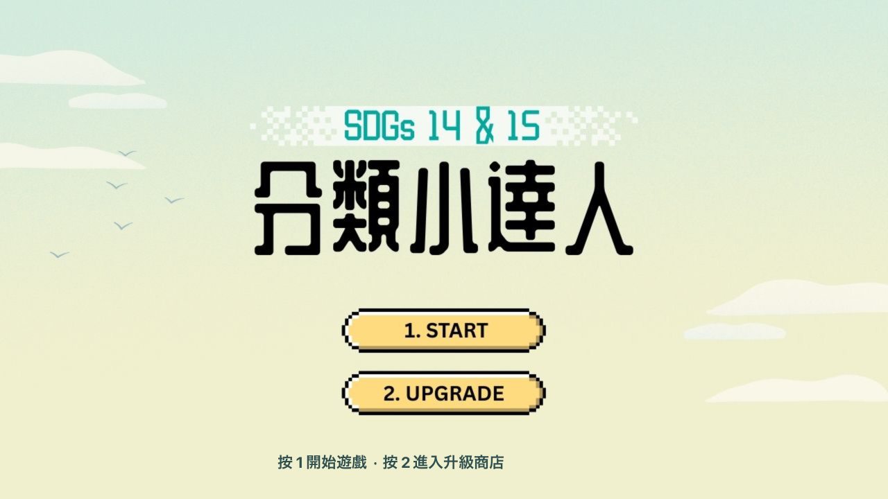
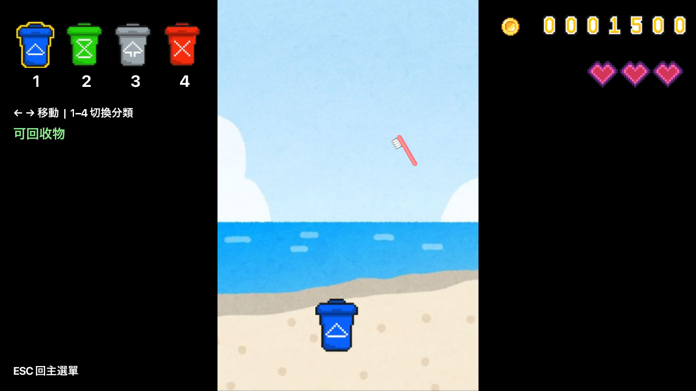
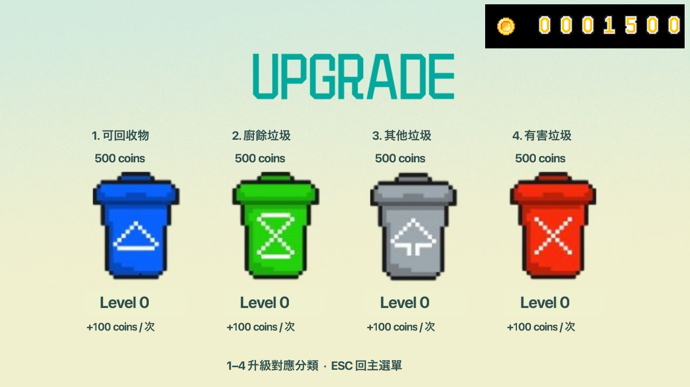
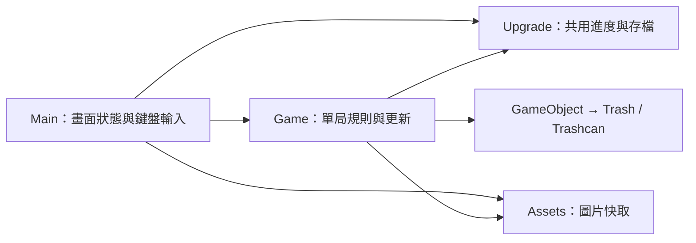

# 分類小達人 · Trash Sorting Game

Java 程式設計期末專題，以 **SDGs 14 海洋生態與 SDGs 15 陸域生態**為主題的 JavaFX 桌面遊戲。
玩家在海灘上移動垃圾桶、切換分類，接住掉落的垃圾，累積金幣並升級各類垃圾桶。



## 作品特色

- **四種垃圾分類**：可回收物、廚餘、其他垃圾與有害垃圾，各有三種掉落物圖片。
- **即時操作與動畫**：方向鍵移動、數字鍵切換，垃圾會隨機掉落並旋轉。
- **生命與學習提示**：每局三顆愛心；分類錯誤會顯示五秒分類說明，漏接也會扣生命。
- **成長系統**：正確分類獲得金幣，升級後增加對應類別的獎勵，進度自動儲存。
- **逐步增加難度**：隨生成數量增加掉落速度與頻率，生成間隔設有下限。

| 遊戲畫面 | 升級商店 |
| --- | --- |
|  |  |

## 快速開始

需要 **JDK 21**、桌面圖形環境，以及首次啟動時的網路連線。
專案附有 Maven Wrapper，會自動下載 Maven 與對應作業系統的 JavaFX，不需要另外安裝 Maven 或 JavaFX SDK。

確認 Java 版本：

```bash
java -version
```

**macOS / Linux**，在專案目錄執行：

```bash
./run.sh
```

**Windows**，在專案目錄開啟 PowerShell 或命令提示字元：

```powershell
.\run.bat
```

也可以直接使用 `./mvnw javafx:run`，Windows 對應指令為 `.\mvnw.cmd javafx:run`。
若 shell 腳本缺少執行權限，先執行 `chmod +x mvnw run.sh`。
使用 IntelliJ IDEA 或 VS Code 時，將根目錄的 `pom.xml` 匯入為 Maven 專案，並將專案 JDK 設為 21。

## 操作與規則

| 畫面 | 按鍵 | 功能 |
| --- | --- | --- |
| 主選單 | `1` / `2` | 開始遊戲／進入升級商店 |
| 分類提示 | `Enter` 或 `Esc` | 開始新的一局 |
| 遊戲中 | `←` / `→` | 左右移動垃圾桶 |
| 遊戲中 | `1` / `2` / `3` / `4` | 切換藍／綠／灰／紅垃圾桶 |
| 遊戲中 | `Esc` | 回主選單，保留已取得的金幣 |
| 遊戲結束 | `R` | 再玩一次 |
| 升級商店 | `1`–`4` | 購買對應分類的一次升級 |
| 升級商店 | `Esc` | 回主選單 |

數字鍵也支援數字鍵盤。商店中按住數字鍵只購買一次，放開後才能再次購買。

| 按鍵 | 顏色 | 分類 |
| --- | --- | --- |
| `1` | 藍 | 可回收物 |
| `2` | 綠 | 廚餘垃圾 |
| `3` | 灰 | 其他垃圾 |
| `4` | 紅 | 有害垃圾 |

新玩家金幣與等級皆為 0。等級為 `L` 時，正確接住該分類可獲得 `100 + 10 × L` 金幣；
下一次升級需要 `500 × 2^L` 金幣。各分類獨立升級，最高 15 級，金幣上限為 9,999,999。
遊戲採用原專題圖卡中的分類方式。

## 技術與架構

| 項目 | 使用技術 |
| --- | --- |
| 語言／介面 | Java 21、JavaFX 21.0.7 |
| 繪圖／遊戲迴圈 | Canvas、GraphicsContext、AnimationTimer |
| 建置 | Maven 3.9.9、Maven Wrapper 3.3.4 |
| 存檔 | Java Properties、暫存檔替換寫入 |
| 驗證 | JUnit 5、JavaFX 畫面測試、GitHub Actions |



`GameObject` 封裝位置與碰撞範圍，`Trash` 與 `Trashcan` 繼承共用行為；`TrashType` 定義四種分類。
遊戲邏輯與繪圖分開，移動與掉落依經過時間計算，避免螢幕更新率改變遊戲速度。
主程式與商店共用一份 `Upgrade`，畫面繪製不會反覆讀取磁碟；圖片從 classpath 載入並快取。

```text
.
├── src/main/java/com/trashsorter/   # 遊戲程式與資料管理
├── src/main/resources/img/         # 原專題的 41 張圖片
├── src/test/java/com/trashsorter/   # 規則、存檔與畫面測試
├── docs/images/                    # 實際執行截圖
├── docs/                          # 版本判定、素材與上傳說明
├── examples/save.txt               # 原專題存檔範例
├── .github/workflows/ci.yml         # 自動建置與測試
├── .mvn/、mvnw、mvnw.cmd           # Maven Wrapper
├── pom.xml
└── run.sh / run.bat
```

## 存檔與原始進度

預設存檔位置為使用者家目錄下的 **`.trash-sorting-game/save.properties`**。
例如 macOS / Linux 為 `~/.trash-sorting-game/save.properties`，Windows 為 `%USERPROFILE%\.trash-sorting-game\save.properties`。
重新啟動會載入金幣與升級等級，每一局的愛心重新計算。

要沿用原本的測試進度，可在關閉遊戲後，把 `examples/save.txt` 複製到上述位置並改名為 `save.properties`。
這份範例有 3,000 金幣，四類等級依序為 1、4、1、1；請先備份既有進度。
也可透過 Java 系統屬性 `trashsorter.save` 指定其他檔案，測試不會使用真實玩家存檔。

## 建置與測試

```bash
# 編譯、執行核心測試並產生 JAR
./mvnw verify

# 額外開啟 JavaFX 視窗，測試畫面、資源、鍵盤與商店流程
./mvnw verify -Dui.tests=true

# Linux 無桌面環境時，需先備有 Xvfb
xvfb-run -a ./mvnw verify -Dui.tests=true
```

Windows 將 `./mvnw` 換成 `.\mvnw.cmd`。一般建置執行 12 項核心測試，略過需桌面的畫面測試；
啟用 `ui.tests` 後共執行 13 項測試，並在 `target/ui-screenshots/` 產生截圖。
CI 設定包含三種作業系統的核心建置，以及 Linux 虛擬螢幕的畫面測試。

產物為 `target/trash-sorting-game-1.0.0.jar`，內含程式與圖片，**仍需 JavaFX 執行環境**；
目前建議透過 Maven 指令啟動，尚未提供可直接雙擊安裝的應用程式。

## 專案整理紀錄

這是由保留下來的 Java 期末專題整理而成的作品展示版。
原始資料夾只有一套三個 Java 檔案，沒有版號或 Git 歷史，因此無法證實它是當年最後提交版。
本版保留原名稱、主題、美術及主要玩法，補上可重現建置、跨平台資源載入、存檔防護與測試。

- [版本判定與整理內容](docs/VERSION_AUDIT.md)
- [本機驗證紀錄與平台範圍](docs/VALIDATION.md)
- [放上 GitHub 的步驟與作品簡介](docs/GITHUB_PUBLISH.md)
- [圖片素材與第三方元件說明](docs/ASSETS.md)

建置方式參考 [OpenJFX 官方文件](https://openjfx.io/openjfx-docs/) 與 [Apache Maven Wrapper 文件](https://maven.apache.org/tools/wrapper/)。
